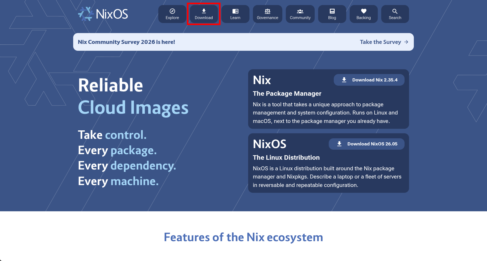
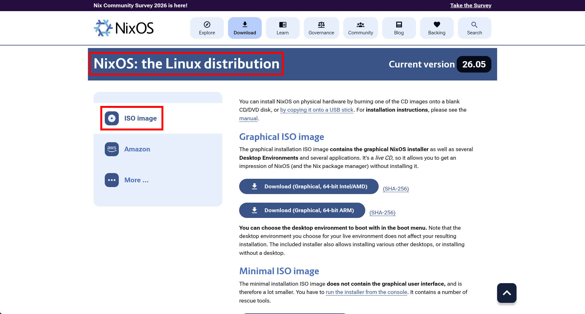
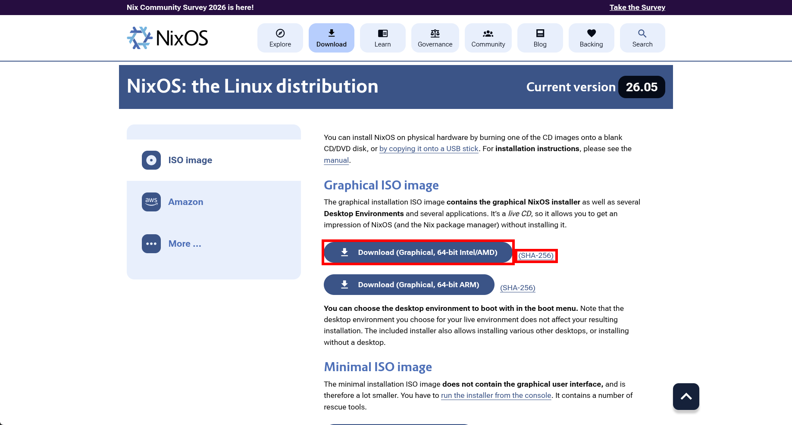

# インストールメディア作成

Linux 環境で NixOS の USB インストールメディアを作成する手順。

> [!Warning]
> `dd` コマンドを使用する際、出力先（`of=`）を間違えるとデータを失う恐れがある。  
> デバイス名の確認は慎重に行うこと。

## 目次

- [ISO イメージファイルのダウンロード](#iso-イメージファイルのダウンロード)
- [ファイル検証](#ファイル検証)
- [USB メモリへ書き込み](#usb-メモリへ書き込み)
- [参考](#参考)

---

## ISO イメージファイルのダウンロード

1. [NixOS 公式サイト](https://nixos.org/) へアクセスする。
2. **Download** をクリックする。



3. **NixOS: the Linux distribution** セクションの **ISO image** を開く。



4. **Graphical ISO image** から以下の 2 つのファイルをダウンロードし、同一ディレクトリ（例: `~/Downloads`）に保存する。
   - **Download (Graphical, 64-bit intel/AMD):** ISO イメージファイル `nixos-graphical-(バージョン番号)-x86_64-linux.iso`
   - **(SHA-256):** ISO イメージファイル検証用ファイル `nixos-graphical-(バージョン番号)-x86_64-linux.iso.sha256`



## ファイル検証

1. ターミナルを起動する。
2. ダウンロードしたディレクトリへ移動する。

例:

```bash
cd ~/Downloads
```

3. 検証する。

```bash
sha256sum -c --ignore-missing nixos-graphical-(バージョン番号)-x86_64-linux.iso.sha256
```

> [!NOTE]
> **nixos-graphical-(バージョン番号)-x86_64-linux.iso: 完了** または **OK** と表示されれば正常。

## USB メモリへ書き込み

1. USB メモリを接続し、デバイス名を特定する。

```bash
lsblk
```

> [!NOTE]
> 以降の手順ではデバイス名を `/dev/sdX` として進める。

2. USB メモリへ ISO イメージファイルを書き込む。

```bash
sudo dd bs=4M if=nixos-graphical-(バージョン番号)-x86_64-linux.iso of=/dev/sdX conv=fsync oflag=direct status=progress
```

> [!Note]
> `if` には ISO イメージファイル名、`of` には USB デバイス名を指定する。

3. キャッシュを完全に書き込む。

```bash
sync
```

4. USB メモリを取り外す。

```bash
udisksctl unmount -b /dev/sdX1  # パーティションがマウントされている場合
```

```bash
udisksctl power-off -b /dev/sdX
```

## 参考

- [NixOS Manual - Obtaining NixOS](https://nixos.org/manual/nixos/stable/#sec-obtaining)
